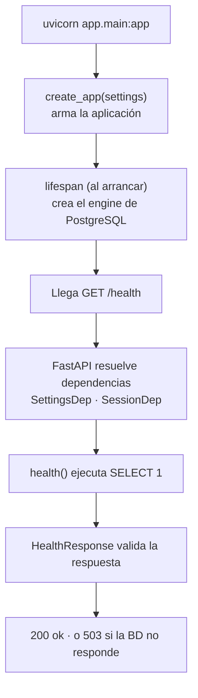

# 00 · Recorrido del proyecto

## Tres capas de trabajo

| Capa | Qué es | Dónde está |
|---|---|---|
| **Código** | La API | `app/`, `tests/`, `alembic/` |
| **Proceso de calidad** | Herramientas que revisan el código automáticamente | `pyproject.toml`, `.pre-commit-config.yaml`, `.github/workflows/ci.yml` |
| **Conocimiento** | Por qué está hecho así y en qué punto vamos | `docs/`, `CLAUDE.md` |

## Qué pasa cuando alguien llama a `GET /health`

### Las piezas

- **`Settings`** ([config.py](../../app/core/config.py)): `pydantic-settings` lee variables de entorno
  o `.env` y las convierte en un objeto tipado. Un valor inválido (`DEBUG=talvez`) impide arrancar.
- **App factory** ([main.py](../../app/main.py)): `create_app(settings)` recibe la configuración, así
  los tests crean su propia app apuntando a `torneos_test`.
- **`lifespan`**: código que corre al arrancar (crear el *pool* de conexiones) y al apagar (cerrarlo).
- **Dependencias** ([deps.py](../../app/api/deps.py)): la ruta declara lo que necesita y FastAPI se lo da.
  Ver [02 · Inyección de dependencias](02-inyeccion-de-dependencias.md).
- **Schemas** ([schemas/health.py](../../app/schemas/health.py)): la forma exacta de la entrada/salida;
  también generan la documentación de `/docs`.

## Base de datos

- **Docker** ([docker-compose.yml](../../docker-compose.yml)) levanta PostgreSQL en un contenedor
  aislado: `docker compose up -d` lo enciende, `docker compose down` lo detiene.
- **SQLAlchemy** (ORM): tablas como clases de Python; todas heredan de `Base` ([models/base.py](../../app/models/base.py)).
- **Alembic**: control de versiones de la estructura de la base. Ver [03 · Migraciones](03-migraciones.md).

## Tests

Un **fixture** es algo que pytest prepara antes de cada test. El fixture `client` entrega una app
nueva conectada a `torneos_test`, nunca a tu base de desarrollo.

## Las tres redes de seguridad

| Herramienta | Detecta |
|---|---|
| Ruff (lint) | Errores y malas prácticas (variable sin usar, import faltante) |
| Ruff format | Estilo inconsistente |
| mypy (strict) | Errores de tipos |
| pytest + coverage | Comportamiento incorrecto; código sin probar (< 80%) |

Corren en tres momentos: **a mano**, **al hacer commit** (pre-commit; si falla, no hay commit) y
**en cada PR** (GitHub Actions, en Linux limpio con PostgreSQL real). Como `main` está protegida,
no se puede mergear si el CI falla. Cada red atrapa lo que la anterior dejó pasar.

## Git

- Cada cambio en una **rama** (`feat/...`, `docs/...`) que entra a `main` por **Pull Request**.
- **Conventional Commits**: `feat(db): ...` — el prefijo dice el tipo de cambio.
- **Tags** como `v0.1.0` marcan versiones ([SemVer](https://semver.org/lang/es/): MAYOR.MENOR.PARCHE).
- **CHANGELOG**: cambios anotados en `Unreleased` hasta que se publica una versión.

## Documentación e IA

- **ADR** ([decisiones/](../decisiones/README.md)): cada decisión con sus alternativas. Si te preguntan
  "¿por qué PostgreSQL y no SQLite?", la respuesta está en el ADR-0007.
- **[CLAUDE.md](../../CLAUDE.md)**: instrucciones que la IA lee al inicio de cada sesión.

## Ejercicios

1. Con Docker arriba: `.venv\Scripts\uvicorn.exe app.main:app --reload` y abre <http://localhost:8000/docs>.
2. En [health.py](../../app/api/routes/health.py) cambia `"ok"` por `"bien"`, corre `pytest` y lee el error. Deshazlo.
3. En [config.py](../../app/core/config.py) cambia `debug: bool = False` por `debug: bool = "no"` y corre `mypy`.
4. En `.env` pon `ENVIRONMENT=production` y mira qué devuelve `/health`.
5. En GitHub → pestaña **Actions**, abre la última ejecución y expande cada paso.
