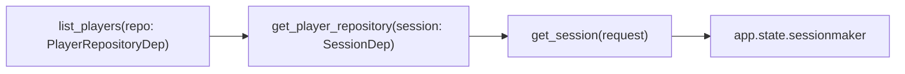

# 02 · Inyección de dependencias

## El problema

Sin inyección de dependencias, cada ruta consigue por sí misma lo que necesita:

```python
@router.get("/players")
async def list_players():
    settings = Settings()  # lee la configuración
    engine = create_async_engine(settings.database_url)  # conexión NUEVA cada vez
    async with AsyncSession(engine) as session:
        ...
```

1. **Repetición**: las mismas líneas en 30 rutas.
2. **Desperdicio**: una conexión nueva por petición.
3. **No se puede testear**: la ruta siempre usa la base real.

## La idea

La ruta **declara lo que necesita** y alguien de afuera (FastAPI) **se lo entrega**. Como en una obra:
el electricista no fabrica sus herramientas, se las pasan.

```python
async def health(settings: SettingsDep, session: SessionDep, ...):
```

La ruta no sabe de dónde viene la sesión, y no le importa.

## Cómo funciona en el proyecto ([deps.py](../../app/api/deps.py))

**Paso 1 — la función proveedora**

```python
async def get_session(request: Request) -> AsyncIterator[AsyncSession]:
    sessionmaker = request.app.state.sessionmaker  # creado en el lifespan
    async with sessionmaker() as session:
        yield session  # ← se entrega a la ruta
        # ← al terminar la petición, se cierra sola
```

El `yield` divide la función en **antes** de la petición (abrir) y **después** (cerrar). Aunque la ruta
lance un error, el cierre se ejecuta.

**Paso 2 — un alias corto**

```python
SessionDep = Annotated[AsyncSession, Depends(get_session)]
```

`Annotated[Tipo, extra]`: el tipo es `AsyncSession` (para mypy y el editor), y FastAPI lo obtiene
llamando a `get_session`. Así no se repite `Depends(...)` en cada ruta.

**Paso 3 — las dependencias se encadenan**



En la Fase 3 aparecerá otra cadena: `start_tournament(user: CurrentUserDep)` →
`get_current_user(token, session)`. Cada pieza es pequeña y hace una sola cosa.

## La ventaja en los tests

Hoy cambiamos la base pasando otro `Settings` a `create_app()`. FastAPI además permite
**reemplazar cualquier dependencia** en un test:

```python
app.dependency_overrides[get_current_user] = lambda: usuario_falso_admin
```

Así se prueba "un admin puede iniciar un torneo" sin hacer login real (lo usaremos en la Fase 3).

## La idea de fondo

No es algo exclusivo de FastAPI: es un principio general — **"no construyas lo que necesitas; recíbelo"**.
`create_app(settings)` aplica la misma idea: la app recibe su configuración en vez de buscarla.

## Errores típicos

- **Crear recursos caros dentro de la ruta** (engine, clientes HTTP) en vez de recibirlos.
- **Olvidar el `yield`** en una dependencia que debe limpiar algo: el recurso nunca se cierra.
- **Lógica de negocio en la dependencia**: las dependencias proveen cosas; no deciden reglas.

## Ejercicios

1. Abre <http://localhost:8000/docs>: las dependencias no aparecen como parámetros. ¿Por qué?
   (Pista: `Request` lo pone FastAPI, no el cliente.)
2. Crea en un test un `app.dependency_overrides[get_app_settings]` que devuelva un `Settings` con
   `environment="production"` y verifica que `/health` lo refleje.
