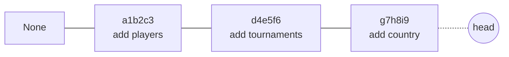

# 03 · Migraciones con Alembic

## El problema

El código define tablas (una clase `Player` con `name` y `rating`), pero la base de datos es
**otro sistema** con su propia estructura. Si agregas `country` al modelo, la tabla **no se entera sola**.

Y no hay una sola base: tu base de desarrollo, `torneos_test`, la del CI (nueva en cada ejecución) y
producción, con **datos reales que no se pueden perder**. Todas deben llegar a la misma estructura,
de forma repetible y sin borrar datos.

## La solución: un historial de cambios

Una migración es un archivo que describe **un cambio** y cómo deshacerlo:

```python
# alembic/versions/2026_10_27_1530-a1b2c3_add_players_table.py
revision = "a1b2c3"
down_revision = None  # ← es la primera


def upgrade() -> None:
    op.create_table(
        "players",
        sa.Column("id", sa.Integer(), primary_key=True),
        sa.Column("name", sa.String(100), nullable=False),
    )


def downgrade() -> None:
    op.drop_table("players")
```

Cada migración apunta a la anterior y forman una **cadena** (como los commits de git, pero para la
estructura de la base):



## ¿Cómo sabe Alembic qué falta?

Alembic crea en la base una tabla diminuta, `alembic_version`, con una fila: la versión actual.
Con `alembic upgrade head` razona: "esta base está en `d4e5f6`; lo más nuevo es `g7h8i9`; aplico
solo lo que falta". Por eso es seguro ejecutarlo muchas veces.

## `--autogenerate`: que Alembic escriba la migración

```
alembic revision --autogenerate -m "add country to players"
```

Compara **los modelos** (`Base.metadata`) con **la base real** y escribe la diferencia. Para eso
necesita *ver* todos los modelos — por eso [alembic/env.py](../../alembic/env.py) hace
`from app import models` y [models/\_\_init\_\_.py](../../app/models/__init__.py) importa cada modelo.
Si olvidas importar uno, Alembic cree que debe **borrar** su tabla.

## ⚠️ Siempre revisar la migración generada

Autogenerate no entiende intenciones. Caso clásico: **renombrar una columna** `name` → `full_name`.
Alembic ve "desapareció `name`, apareció `full_name`" y genera:

```python
op.drop_column("players", "name")  # 💥 borra todos los nombres
op.add_column("players", sa.Column("full_name", ...))
```

Lo correcto, editado a mano:

```python
op.alter_column("players", "name", new_column_name="full_name")  # ✅ conserva los datos
```

## Columnas obligatorias en tablas con datos

Si agregas `country` con `nullable=False` y ya hay 500 jugadores, ¿qué valor reciben? PostgreSQL
rechaza la migración. Soluciones:

- `server_default="CL"`: los registros existentes reciben un valor.
- O en tres pasos: agregar la columna opcional → rellenar datos → marcarla obligatoria.

## La red de seguridad del CI

```yaml
alembic upgrade head   # ¿las migraciones se aplican sin errores en una base vacía?
alembic check          # ¿los modelos coinciden con las migraciones?
```

Si alguien cambia un modelo y olvida la migración, `alembic check` falla y el PR no se puede mergear.

## La convención de nombres ([models/base.py](../../app/models/base.py))

```python
"uq": "uq_%(table_name)s_%(column_0_name)s",
```

Sin ella, PostgreSQL inventa nombres para las restricciones (`players_name_key1`). Para modificarlas
después, la migración necesita el nombre exacto. Con la convención siempre es `uq_players_name`.

## Comandos

| Comando | Qué hace |
|---|---|
| `alembic revision --autogenerate -m "..."` | Crea una migración comparando modelos con la base |
| `alembic upgrade head` | Aplica las migraciones pendientes |
| `alembic downgrade -1` | Deshace la última migración |
| `alembic current` | Muestra la versión actual de la base |
| `alembic history` | Muestra la cadena completa |
| `alembic check` | Falla si hay cambios de modelo sin migración |

## Ejercicios

1. Con Docker arriba: `.venv\Scripts\alembic.exe current` y luego `alembic history`.
2. `alembic downgrade -1` y después `alembic upgrade head`. Mira la tabla con
   `docker compose exec db psql -U torneos -c "\dt"` entre cada paso.
3. Agrega temporalmente `country: Mapped[str | None]` a `Player`, corre `alembic check` y lee el
   error. Genera la migración con `--autogenerate`, léela, y luego descarta ambos cambios.
