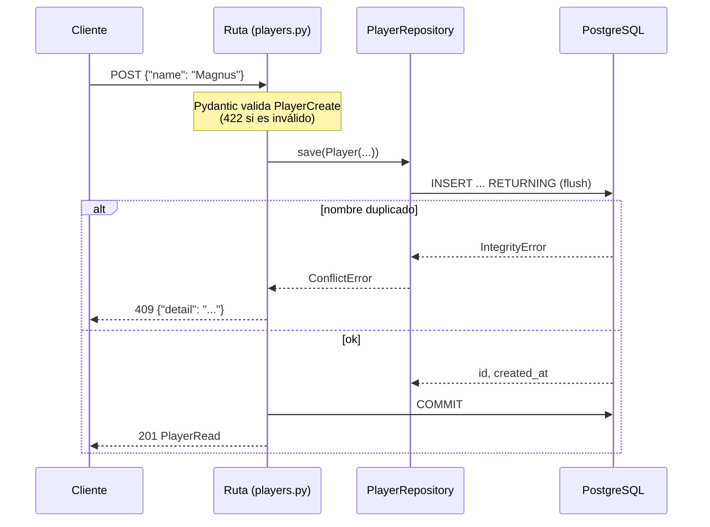
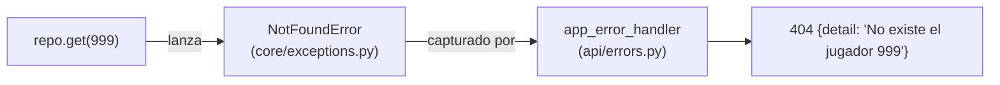

# 04 · CRUD de jugadores: repositorios, errores y paginación

Primer recurso real de la API: crear, listar, ver, actualizar y eliminar jugadores.
Decisión formal: [ADR-0008](../decisiones/ADR-0008-repositorios-y-errores.md).

## El recorrido de `POST /api/v1/players`



## 1. Modelo, schemas: tres clases distintas para "un jugador"

| Clase | Archivo | Para qué |
|---|---|---|
| `Player` | [models/player.py](../../app/models/player.py) | La **tabla** (SQLAlchemy) |
| `PlayerCreate` | [schemas/player.py](../../app/schemas/player.py) | Lo que el cliente **puede enviar** al crear |
| `PlayerUpdate` | ídem | Lo que el cliente puede **cambiar** (solo `name`) |
| `PlayerRead` | ídem | Lo que la API **devuelve** |

¿Por qué no una sola clase? Porque cada una tiene reglas distintas: el cliente no puede enviar `id`
ni `created_at`; el `rating` se elige al crear pero no se edita a mano (lo cambiará el cálculo ELO).
Si mañana agregamos un campo interno a la tabla, no se filtra por accidente en la respuesta.

`from_attributes=True` en `PlayerRead` le permite a Pydantic leer un objeto `Player` directamente.

### Validación declarativa

```python
PlayerName = Annotated[str, StringConstraints(strip_whitespace=True, min_length=1, max_length=100)]
rating: int = Field(default=1200, ge=0, le=4000)
```

Pydantic recorta espacios, rechaza `""`, `"   "` y nombres de 101 caracteres, y responde **422**
con el detalle del error, sin escribir un solo `if`.

## 2. El patrón repositorio

[PlayerRepository](../../app/repositories/player_repository.py) reúne **todas las consultas** de
jugadores. La ruta pide `repo.get(5)`; no sabe nada de `select(...)`.

- **Ventaja**: la lógica de torneos (Fase 2) reutilizará `repo.get(...)` sin repetir SQL.
- **Regla**: el repositorio hace `flush`, **no `commit`**.

### flush vs commit

| | `flush()` | `commit()` |
|---|---|---|
| Envía el SQL a la base | ✅ | ✅ |
| Detecta errores (duplicado) | ✅ ahora | ✅ |
| Hace los cambios permanentes | ❌ (se pueden deshacer) | ✅ |

El repositorio hace `flush` para enterarse **ya** si el nombre está repetido. La ruta hace `commit` al
final, cuando todo salió bien. Así, en la Fase 2, "iniciar torneo" podrá crear 8 partidas y cambiar el
estado del torneo en **una sola transacción**: o se guarda todo, o nada.

## 3. Errores de aplicación → HTTP



El repositorio **no sabe** que existe HTTP: lanza `NotFoundError`. Un manejador global, registrado en
`create_app()`, lo traduce a 404. Ventajas: las capas internas no dependen de FastAPI, y todas las
respuestas de error tienen el mismo formato.

### ¿Por qué no preguntar antes "¿existe ese nombre?"

```python
if await repo.get_by_name("Magnus"):  # petición A: no existe
    ...  # petición B: tampoco existe (aún)
await repo.save(...)  # A y B insertan → ¡duplicado!
```

Es una **condición de carrera**. La única garantía real es la restricción `UNIQUE` de la base; el
repositorio captura el `IntegrityError` y lo convierte en `ConflictError` (409).

## 4. Paginación

```
GET /api/v1/players?limit=2&offset=2&search=mag
→ {"items": [...], "total": 5, "limit": 2, "offset": 2}
```

- `limit`: cuántos (1–100, para que nadie pida un millón de filas).
- `offset`: cuántos saltar.
- `total`: cuántos hay en total con ese filtro (para dibujar "página 2 de 3").
- Orden fijo por `id`: sin `ORDER BY`, PostgreSQL puede devolver las páginas en distinto orden.

`Page[PlayerRead]` es un **schema genérico**: el mismo `Page` servirá para torneos y partidas.

### `autoescape=True` en la búsqueda

`search` usa `ILIKE '%texto%'`. En SQL, `%` y `_` son comodines: sin escapar, buscar `%` devolvería
**todos** los jugadores. Con `autoescape=True` se buscan como texto literal (hay un test para eso).

## 5. Tests de integración con base real

[tests/integration/conftest.py](../../tests/integration/conftest.py):

1. `migrated_database` (una vez por sesión): aplica **las migraciones reales** a `torneos_test`.
   Los tests validan también que las migraciones funcionan.
2. `clean_database` (antes de cada test): `TRUNCATE` de todas las tablas. Cada test empieza vacío y
   no depende del orden en que se ejecutan.
3. `client`: la app conectada a `torneos_test`.

`@pytest.mark.parametrize` corre el mismo test con varios datos: 6 payloads inválidos en un solo test.

## 6. Dos bugs reales de este PR (y qué enseñan)

**Bug 1 — leer un objeto después de `rollback`.** En `save()`, el mensaje de error usaba
`player.name` *después* del `rollback()`. Tras un rollback, SQLAlchemy **expira** los objetos: leer un
atributo dispara una consulta implícita, y en modo async eso está prohibido. El test del 409 en
`PATCH` lo detectó. Solución: guardar `name` antes del `flush`.

**Bug 2 — la cobertura mentía.** El reporte marcaba líneas como no ejecutadas aunque los tests pasaban
por ellas. SQLAlchemy async ejecuta código dentro de *greenlets* y coverage no los seguía. Solución:
`concurrency = ["greenlet", "thread"]` en `pyproject.toml`. Lección: una métrica también puede estar mal.

Ambos casos muestran el valor de escribir tests de los caminos de **error**, no solo del caso feliz.

## Errores típicos

- Olvidar `await session.commit()` en una ruta que escribe: responde 201 pero el dato desaparece.
- Usar el mismo schema para crear y leer: se filtran campos internos o se permite editar el `id`.
- Paginar sin `ORDER BY`.
- Capturar `Exception` en vez de `IntegrityError`: escondes errores que no entiendes.

## Ejercicios

1. Levanta la API y en <http://localhost:8000/docs> crea 3 jugadores, lista con `limit=2`, y prueba
   crear un nombre duplicado.
2. Quita `await session.commit()` de `create_player`. ¿Qué test falla y por qué?
3. Quita `autoescape=True` y corre `pytest -k wildcards`.
4. Agrega a `PlayerRead` un campo calculado `display_name` (por ejemplo `"Magnus (1200)"`) con
   `@computed_field` de Pydantic, y su test.
