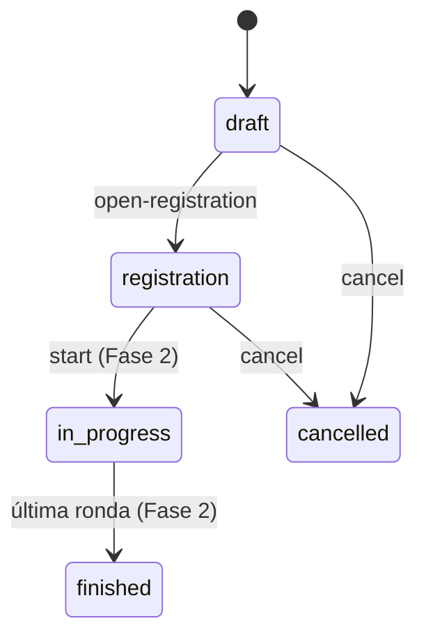
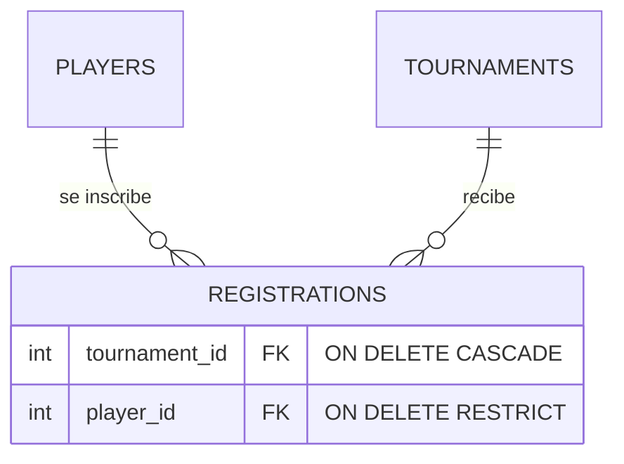

# 05 · Torneos e inscripciones: máquina de estados, relaciones y concurrencia

Decisión formal: [ADR-0009](../decisiones/ADR-0009-ciclo-de-vida-torneo.md).

## 1. Máquina de estados

### El problema

Un torneo no es un simple registro editable: **lo que se puede hacer depende de en qué etapa está**.
No tiene sentido inscribir jugadores en un torneo terminado, ni cambiar de suizo a eliminación directa
cuando ya hay gente inscrita. Si esas reglas se reparten como `if` sueltos por las rutas, tarde o
temprano una ruta se olvida de una.

### Cómo funciona

Una **máquina de estados** declara los estados posibles y qué transiciones son válidas:



En el código es **una tabla** ([tournament_lifecycle.py](../../app/services/tournament_lifecycle.py)):

```python
ALLOWED_TRANSITIONS = {
    TournamentStatus.DRAFT: frozenset({TournamentStatus.REGISTRATION, TournamentStatus.CANCELLED}),
    TournamentStatus.REGISTRATION: frozenset({TournamentStatus.IN_PROGRESS, TournamentStatus.CANCELLED}),
    ...
}
```

Una sola función la consulta:

```python
def ensure_transition(current, target):
    if target not in ALLOWED_TRANSITIONS[current]:
        raise ConflictError(...)
```

El diagrama de arriba y la tabla dicen lo mismo: si cambias uno, cambias el otro.

### Acciones en vez de `PATCH status`

Para cambiar de estado hay **endpoints de acción** (`POST /tournaments/1/cancel`), no
`PATCH {"status": "cancelled"}`. Motivo: una transición no es "editar un campo", es **un evento**
con reglas y, en la Fase 2, con efectos (`start` generará las partidas). El campo `status` ni siquiera
existe en `TournamentCreate` / `TournamentUpdate`: si un cliente lo envía, se ignora (hay un test).

## 2. Lógica pura → tests unitarios

Las reglas reciben **valores simples** (un estado, dos números), no objetos de base de datos:

```python
def ensure_has_capacity(max_players: int | None, registered_count: int) -> None:
```

Por eso se prueban sin PostgreSQL, sin HTTP, sin fixtures:

| | Tests unitarios (`tests/unit/`) | Tests de integración (`tests/integration/`) |
|---|---|---|
| Qué prueban | Una regla aislada | El recorrido completo HTTP → BD |
| Necesitan | Nada | PostgreSQL, migraciones, TestClient |
| Velocidad | 51 tests en 0,06 s | ~60 tests en ~10 s |
| Sirven para | Recorrer **todos** los casos | Comprobar que las piezas encajan |

Truco usado: `INVALID_TRANSITIONS` se **calcula** como "todas las combinaciones menos las válidas".
Así, si alguien agrega un estado nuevo, los tests de transiciones inválidas lo cubren solos.

## 3. Enums: Python ↔ PostgreSQL

```python
class TournamentStatus(StrEnum):
    DRAFT = "draft"
```

- `StrEnum` (Python 3.11): cada miembro **es** un string, así que se serializa a JSON sin esfuerzo.
- En la base se guarda como `VARCHAR` + una restricción `CHECK (status IN ('draft', ...))`.
  La base rechaza valores inválidos aunque alguien escriba SQL a mano.
- `values_callable` hace que se guarde `"draft"` (el valor) y no `"DRAFT"` (el nombre).
- Pydantic rechaza `format: "poker"` con 422 antes de que llegue a la base.

## 4. Relaciones y claves foráneas



`Registration` es una **tabla intermedia** (relación muchos-a-muchos): un jugador está en muchos
torneos y un torneo tiene muchos jugadores.

- **`UNIQUE (tournament_id, player_id)`**: la base impide inscribir dos veces al mismo jugador.
- **`ON DELETE CASCADE`** en `tournament_id`: borrar un torneo borra sus inscripciones.
- **`ON DELETE RESTRICT`** en `player_id`: **no se puede** borrar un jugador inscrito. El repositorio
  traduce ese error a 409 (antes daba 500: fue el bug corregido en este PR).

Cada borrado hace una pregunta de negocio: ¿borrar un torneo debe arrastrar sus inscripciones? Sí.
¿Borrar un jugador debe borrar su historial en torneos? No.

### Índices: uno sobraba

El `UNIQUE (tournament_id, player_id)` crea un índice **ordenado primero por `tournament_id`**. Ese
índice ya sirve para "dame las inscripciones del torneo 5", así que un índice aparte sobre
`tournament_id` sería redundante (ocupa espacio y hace más lentas las escrituras). Para `player_id`
sí hace falta uno propio: el índice compuesto no ayuda a buscar por su segunda columna.
Esto se detectó **revisando la migración generada**.

### `lazy="raise"` y `joinedload`

```python
player: Mapped[Player] = relationship(lazy="raise")
```

Por defecto, SQLAlchemy carga una relación "cuando la tocas" (*lazy loading*). En async eso falla con
un error críptico. Con `lazy="raise"` falla con un mensaje claro, y obliga a cargarla a propósito:

```python
select(Registration).options(joinedload(Registration.player))  # un solo JOIN
```

Sin `joinedload`, listar 100 inscritos haría **101 consultas** (1 para la lista + 1 por jugador): el
famoso **problema N+1**.

## 5. Concurrencia: el último cupo

Torneo con cupo 8 y 7 inscritos. Dos personas se inscriben **al mismo tiempo**:

```
Petición A: cuenta inscritos → 7 → hay cupo → inserta
Petición B: cuenta inscritos → 7 → hay cupo → inserta     ← ¡9 inscritos!
```

Ambas leyeron 7 antes de que la otra insertara. La solución es **bloquear la fila del torneo**:

```python
tournament = await tournaments.get(tournament_id, for_update=True)  # SELECT ... FOR UPDATE
```

La petición B se queda esperando en esa línea hasta que A haga `commit`. Cuando B continúa, cuenta 8
y recibe 409. El bloqueo dura solo lo que dura la transacción. Mismo patrón que el `UNIQUE` del
nombre de jugador: **las garantías de concurrencia las da la base de datos**, no un `if` en Python.

## 6. PATCH parcial y el valor `null`

En `PATCH`, "no enviar un campo" y "enviarlo como `null`" significan cosas distintas:

| Envío | Significado |
|---|---|
| `{}` | No cambiar nada |
| `{"max_players": null}` | Quitar el límite de cupo ✅ |
| `{"name": null}` | Borrar el nombre → **422** (es obligatorio) |

`model_dump(exclude_unset=True)` devuelve solo los campos enviados, y un `model_validator` rechaza
`null` en los obligatorios. Sin ese validador, `{"name": null}` llegaba a la base y causaba un 500.

## Errores típicos

- Escribir las reglas de estado como `if` sueltos en cada ruta.
- Aceptar `status` en el `PATCH` y saltarse la máquina de estados.
- Olvidar `ON DELETE` y descubrir el comportamiento por defecto en producción.
- Recorrer una relación en un bucle sin `joinedload` (N+1).
- "Comprobar y luego actuar" (`if count < max: insert`) sin bloqueo ni restricción en la base.

## Ejercicios

1. En <http://localhost:8000/docs>: crea un torneo con `max_players: 2`, abre inscripciones, inscribe
   2 jugadores e intenta un tercero. Luego cancela el torneo e intenta reabrirlo.
2. Intenta borrar un jugador inscrito. Después borra el torneo cancelado y vuelve a intentarlo.
3. Agrega a `ALLOWED_TRANSITIONS` la transición `registration → draft` ("cerrar inscripciones").
   ¿Qué test unitario falla? Actualiza los tests para que reflejen la nueva regla.
4. Quita `.options(joinedload(...))` de `list_by_tournament` y corre `pytest -k list_registrations`.
   Lee el error que produce `lazy="raise"`.
