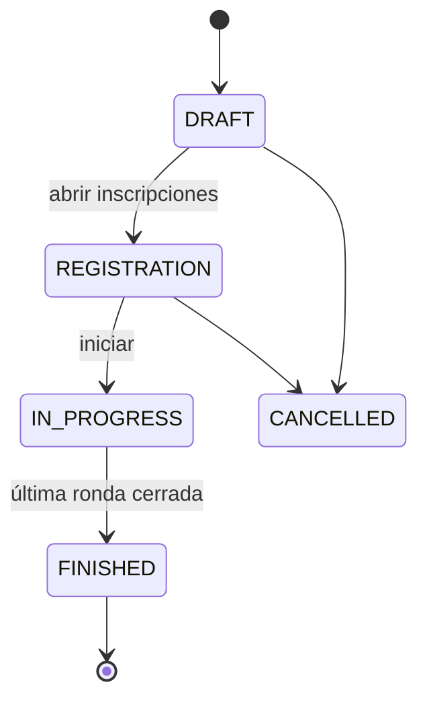

# Glosario del dominio

Vocabulario compartido entre el código, la documentación y los asistentes de IA.
Si un término cambia de significado, se actualiza aquí primero.

| Término | En código | Definición |
|---|---|---|
| Torneo | `Tournament` | Competencia con un formato, participantes inscritos y un ciclo de vida. |
| Participante / Jugador | `Player` | Entidad que compite. Tiene un rating ELO. |
| Inscripción | `Registration` | Relación jugador–torneo; puede incluir el *seed*. |
| Partida | `Match` | Enfrentamiento entre dos participantes dentro de una ronda. |
| Ronda | `round` | Conjunto de partidas que se juegan en paralelo. |
| Formato | `TournamentFormat` | `single_elimination`, `swiss`, `round_robin`. |
| Seed / Siembra | `seed` | Posición inicial según ranking; evita que los mejores se crucen pronto. |
| Bye | `bye` | Pase libre a la siguiente ronda cuando falta rival. Cuenta como victoria. |
| Bracket / Llave | — | Árbol de eliminación directa. |
| Sistema suizo | — | Formato de N rondas fijas donde se empareja a jugadores con puntaje similar sin repetir rival. |
| Emparejamiento | `pairing` | Asignación de rivales para una ronda. |
| Buchholz | `buchholz` | Desempate: suma de los puntos de los rivales enfrentados. |
| Sonneborn-Berger | `sonneborn_berger` | Desempate: suma de puntos de rivales vencidos + mitad de los empatados. |
| ELO | `rating` | Sistema de rating; tras cada partida se ajusta según resultado esperado y factor K. |
| Factor K | `k_factor` | Magnitud máxima del cambio de rating en una partida. |

## Ciclo de vida del torneo

