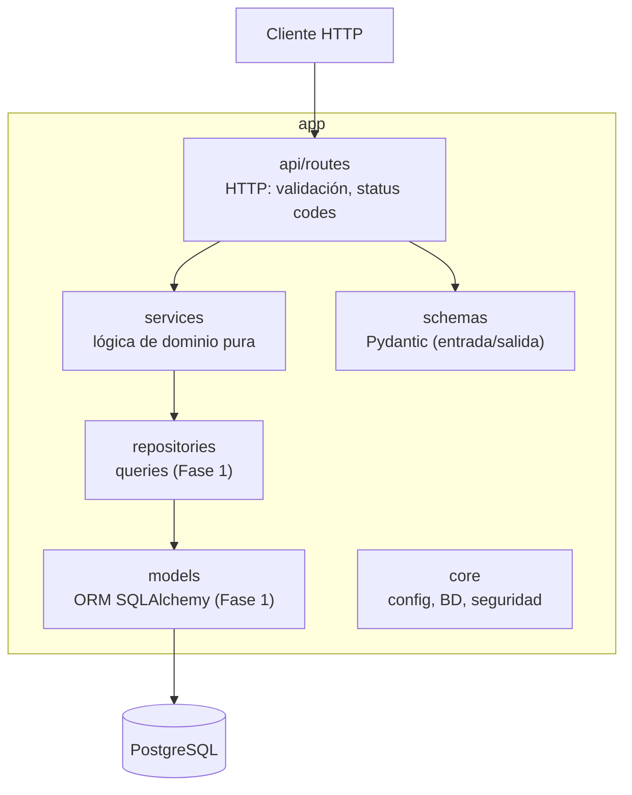

# Visión general de la arquitectura

API REST con FastAPI organizada en capas. La regla central: **la lógica de torneos no depende
de FastAPI ni de la base de datos**, para poder testearla de forma aislada y exhaustiva.

## Capas

## Reglas de dependencia

| Capa | Puede importar | No debe importar |
|---|---|---|
| `api/routes` | `schemas`, `services`, `api/deps`, `core` | `models` directamente para lógica |
| `services` | stdlib, tipos/dataclasses propios | `fastapi`, `sqlalchemy`, `api` |
| `repositories` | `models`, `core.database` | `api`, `schemas` |
| `schemas` | `pydantic` | `models`, `services` |

Los algoritmos (`bracket_generator`, `swiss_system`, `elo_calculator`) reciben y devuelven
estructuras simples. La orquestación (cargar datos → llamar algoritmo → persistir) vive en
servicios de aplicación o en las rutas mediante dependencias.

## Decisiones relacionadas

- [ADR-0002 FastAPI y Pydantic](../decisiones/ADR-0002-fastapi-pydantic.md)
- [ADR-0003 Arquitectura en capas](../decisiones/ADR-0003-arquitectura-en-capas.md)
