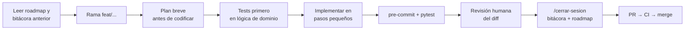

# Uso de IA en el proyecto

Este proyecto se desarrolla con asistencia de IA (Claude Code). Esta nota describe **cómo**
se usa, para que el resultado sea verificable y el autor siga siendo responsable de todo el código.
Decisión formal: [ADR-0006](../decisiones/ADR-0006-uso-de-ia.md).

## Principios

1. **La persona es la autora.** La IA propone; yo entiendo, reviso y decido. Si no puedo
   explicar un cambio en una entrevista, no se mergea.
2. **Mismo proceso para todo.** El código generado pasa por rama, tests, pre-commit, CI y PR.
3. **Los tests son la verificación, no la confianza.** Para lógica de dominio, los casos de prueba
   se escriben o revisan antes de aceptar la implementación.
4. **El contexto vive en el repo, no en el chat.** Reglas en `CLAUDE.md`; decisiones en ADRs;
   estado en el roadmap y la bitácora.
5. **Transparencia.** Los commits con aporte de IA llevan `Co-Authored-By`.
6. **Nada sensible.** No se comparten secretos (`.env`) con la IA; `.claude/settings.json` bloquea su lectura.

## Dónde está el contexto

| Archivo | Rol |
|---|---|
| [`CLAUDE.md`](../../CLAUDE.md) | Reglas, comandos y convenciones que la IA carga en cada sesión |
| [`.claude/settings.json`](../../.claude/settings.json) | Permisos compartidos (qué puede ejecutar sin preguntar, qué tiene prohibido) |
| [`.claude/skills/`](../../.claude/skills/) | Flujos reutilizables: `/adr`, `/cerrar-sesion` |
| `CLAUDE.local.md` / `.claude/settings.local.json` | Preferencias personales — ignorados por git |
| Este vault | Memoria de largo plazo: decisiones, roadmap, bitácora, glosario |

## Flujo de una sesión

## Buenas prácticas al pedir trabajo a la IA

- **Una tarea acotada por pedido** (un endpoint, un algoritmo), no "haz la Fase 2".
- **Pedir un plan antes del código** en cambios grandes, y corregirlo antes de que empiece.
- **Dar criterios de aceptación** concretos: entradas, salidas, casos borde.
- **Pedir que explique** los algoritmos no triviales (suizo, desempates) y documentarlos en el vault.
- **Revisar el diff completo**, no solo el resumen. Desconfiar de tests que solo prueban el caso feliz.
- **Registrar decisiones** con `/adr` cuando la IA y yo elegimos entre alternativas.
- **Reiniciar el contexto** entre tareas no relacionadas; el estado necesario ya está en el vault.

## Qué no delegar

- Decidir el diseño del dominio sin entenderlo.
- Aceptar dependencias nuevas sin revisar qué son y si se mantienen.
- Cambios de seguridad (auth, permisos) sin revisión línea por línea.
